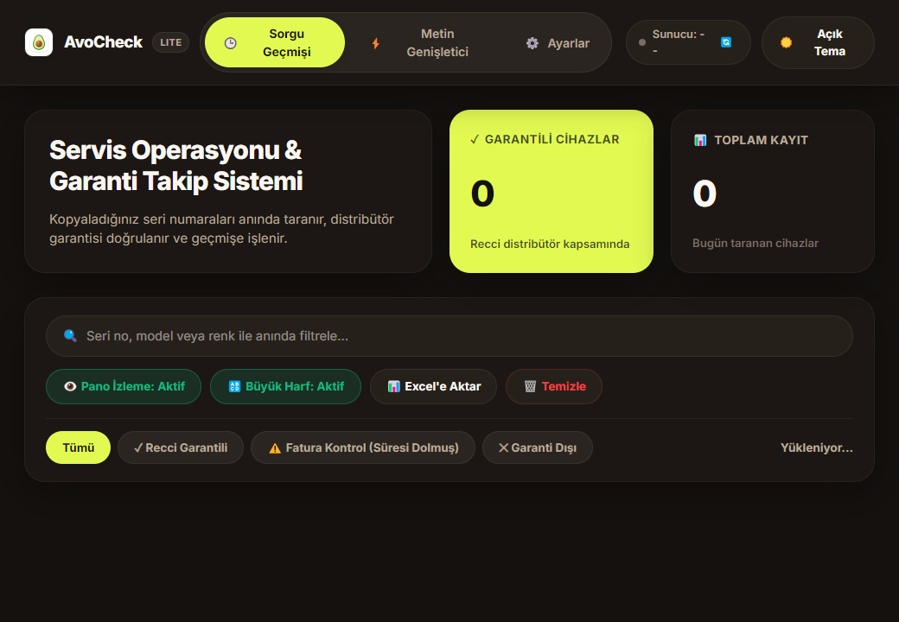
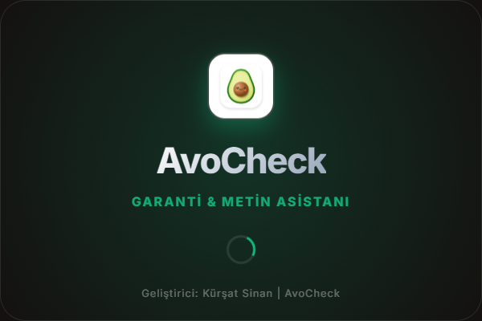
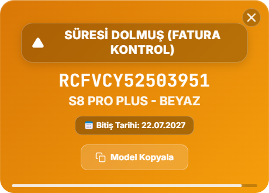
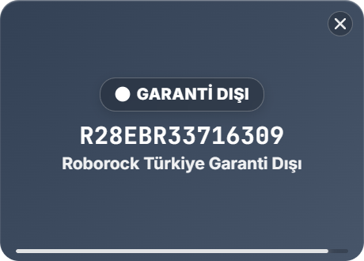

<div align="center">

# 🥑 AvoCheck
### Akıllı Roborock Garanti Takip & Masaüstü Asistanı

[](https://github.com/KursatS/AvoCheck)
[](https://electronjs.org)
[](https://www.typescriptlang.org)
[](https://vitejs.dev)
[](LICENSE)

<p align="center">
  <b>AvoCheck</b>, teknik servis teknisyenleri ve operasyon ekipleri için geliştirilmiş ultra hafif, ışık hızında masaüstü asistanıdır.<br/>
  Panoya kopyalanan Roborock seri numaralarını anında algılar, yetkili servis sunucularından garanti durumunu sorgular, renk kodlu kartlarla bildirir ve sistem genelinde çalışan Espanso benzeri güçlü bir <b>Metin Genişletici (Text Expander)</b> sunar.
</p>

</div>

---

## 📦 Sürüm Mimarisi (Dual Edition)

AvoCheck, servis ihtiyaçlarına göre iki ayrı mimaride sunulmaktadır:

| Özellik | 🥑 AvoCheck Lite *(Bu Dağıtım / `main`)* | 🏢 AvoCheck Full / Kurumsal Sürüm |
| :--- | :---: | :---: |
| **Kullanıcı Girişi** | ❌ Gerekmez (Offline / Anında Açılış) | ✅ Firebase Firestore Yetkilendirme |
| **Pano Tabanlı Garanti Sorgulama** | ✅ Var (Milisaniyeler içinde) | ✅ Var |
| **⚡ Metin Genişletici (Text Expander)** | ✅ Var (Espanso tarzı global hook) | ✅ Var |
| **Renk Kodlu Akıllı Popup'lar** | ✅ Var | ✅ Var |
| **🔔 Tatlı Melodik Sesli Uyarılar** | ✅ Var (Web Audio API Chime) | ✅ Var |
| **İkili Tema (Espresso & Yumuşak Yulaf)** | ✅ Var | ✅ Var |
| **Excel Dışa Aktarım (.xlsx)** | ✅ Var (Tek tıkla) | ✅ Var |
| **📢 Canlı Cihaz Çağrı (Cihaz Sor)** | ❌ Yok (Hafifletildi) | ✅ Var |
| **⚠️ Öncelikli Cihaz Takip Sistemi** | ❌ Yok (Hafifletildi) | ✅ Var |
| **📊 Excel Z Raporu Personel Analizi** | ❌ Yok (Hafifletildi) | ✅ Var |
| **İndirme / Erişim** | Kurulum Paketi (`release/`) | [GitHub Releases Sayfası](https://github.com/KursatS/AvoCheck/releases) veya `full-edition` dalı |

> 💡 **Kurumsal (Ağır) Sürüm Notu:** Canlı personel cihaz çağırma, Firestore öncelikli cihaz senkronizasyonu ve 5 günlük Excel Z Raporu analizini içeren ağır kurumsal sürüme [GitHub Releases](https://github.com/KursatS/AvoCheck/releases) sayfasından `AvoCheck-Full-Setup-v2.6.2.exe` olarak veya `full-edition` Git dalından ulaşabilirsiniz.

---

## 🖼️ Ekran Görüntüleri

### 🖥️ Ana Panel & Açılış Ekranı
| Modern Soft Dashboard (AvoCheck Lite) | Zümrüt Avokado Açılış Ekranı |
| :---: | :---: |
|  |  |

### 🔔 Akıllı Durum Bildirimleri (Popups)
| 🟢 Recci Garantili (`RCFVCY52503951`) | ⚪ Garanti Dışı (`R28EBR33716309`) |
| :---: | :---: |
|  |  |

---

## ✨ Öne Çıkan Özellikler

### 1. ⚡ Işık Hızında Pano Garanti Sorgulama
- Excel'de, mailde veya servis programında Roborock seri numarasını `Ctrl+C` ile kopyaladığınız an sistem arkaplanda yakalar.
- Regex motoru ile Recci servis sunucularından garanti sonucunu çeker ve ekranın sağ altında yaylı pop animasyonuyla fırlatır:
  - 🟢 **RECCI GARANTİLİ:** Cihaz garantili, model ve garanti bitiş tarihi rozetiyle gösterilir.
  - 🟡 **SÜRESİ DOLMUŞ (FATURA KONTROL):** Sistemde süresi dolmuş görünen ancak fatura tarihiyle garantisi devam edebilecek cihazlar için akıllı uyarı rozeti.
  - ⚪ **GARANTİ DIŞI:** Türkiye garantisi bulunmayan cihazlar nötr gri renkte listelenir.
  - 🔴 **BAĞLANTI HATASI:** Ağ kesintisi veya zaman aşımında nazik hata kartı.

### 2. ⚡ Espanso Tarzı Yerel Metin Genişletici (Text Expander)
- Windows'un yerel klavye kancası (`WH_KEYBOARD_LL`) ile çalışan, sıfır gecikmeli C# yardımcı iş parçacığı.
- Windows'un **herhangi bir uygulamasında** (Word, Excel, Chrome, WhatsApp Web, Outlook vb.):
  - `:adres` yazıldığında anında servis açık adresini yapıştırır.
  - `:kargo` yazıldığında anlaşmalı kargo gönderi kodunu döker.
  - `:garanti` yazıldığında standart müşteri bilgilendirme metnini iletir.
- Kullanıcı dostu arayüz üzerinden sınırsız kısayol ekleme, düzenleme, arama ve canlı test sandbox'ı içerir.

### 3. 🔔 Tatlı Melodik Sesli Uyarılar (Audio Cues)
- Sorgu tamamlandığında ekrana bakmaya gerek kalmadan durumu kulağınızla anlayın:
  - **Yeşil (Garantili):** Neşeli iki tonlu zümrüt zili (*Ding-Dong!*).
  - **Sarı (Fatura):** Sıcak kehribar tonu.
  - **Gri (Garantisiz):** Yumuşak ahşap pıt sesi.
- Web Audio API ile sıfır harici dosya bağımlılığıyla çalışır, ayarlardan tek tıkla açılıp kapatılabilir.

### 4. 🎨 Çift Renk Teması (Göz Dostu Tasarım)
- ☕ **Espresso Koyu (Dark Mode):** Sıcak kahve ve kakao tonları (`#14110f`), koyu zemin üzerinde parlayan zümrüt ve neon lime vurgular.
- 🌾 **Yumuşak Yulaf (Light Mode):** Kamaştırıcı beyazlar yerine gözü dinlendiren doğal keten ve yulaf kreması (`#e5e1d8` & `#f2eee5`).

### 5. 📊 Excel Aktarımı & Yerel Önbellek
- Gün içinde sorgulanan tüm cihazları tek tıkla monospaced formatta `.xlsx` dosyasına aktarın.
- SQLite (`better-sqlite3`) yerel önbellek ile daha önce sorgulanmış seriler 3 gün boyunca tekrar ağ isteği yapmadan anında ekrana gelir.

---

## ⌨️ Klavye Kısayolları

| Kısayol | Görev |
| :--- | :--- |
| `Ctrl + Shift + C` | Son sorgulanan cihazın `MODEL - RENK` bilgisini panoya kopyalar |
| `Ctrl + Shift + V` | Panodaki metni otomatik Türkçe büyük harfe çevirip yapıştırır |
| `Ctrl + Shift + M` | Pano izleme servisini geçici olarak duraklatır / devam ettirir |
| `Ctrl + Shift + X` | Yerel SQLite sorgu önbelleğini anında temizler |

---

## 🛠️ Kurulum & Geliştirici Adımları

### Gereksinimler
- Node.js 18+
- npm

### Geliştirici Ortamı (Dev Mode)
```bash
# Bağımlılıkları yükleyin
npm install

# Geliştirici modunu başlatın
npm run dev

# Projeyi derleyin
npm run build
```

### Kurulum (.exe) Paketi Derleme
Ofis bilgisayarları için optimize edilmiş, Türkçe kurulum sihirbazına sahip Windows kurulum paketini üretmek için:
```bash
npm run pack
# veya tek seferde installer üretimi:
npx electron-builder --win nsis --publish never
```
Oluşturulan `AvoCheck Setup 2.6.2.exe` dosyası `release/` klasörüne kaydedilir.

---

## 📁 Dizin Yapısı

```
AvoCheck/
├── assets/                     # Gülen Avokado logoları, ikonlar (.ico/.png) ve ekran görüntüleri
├── build/                      # NSIS Türkçe kurulum sihirbazı görselleri (.bmp) ve makrolar
├── resources/                  # Yerel TextExpander C# Windows hook çalıştırılabilir dosyası
├── src/                        # Modüler TypeScript Kaynak Kodları
│   ├── main.ts                 # Ana Electron süreci, Pano dinleyici & Tray yönetimi
│   ├── windowManager.ts        # Pencereler (Ana Panel, Splash, Akıllı Popup)
│   ├── settingsManager.ts      # Veri dizini taşıma (AvoCheck) & Kullanıcı ayarları
│   ├── textExpanderManager.ts  # C# Klavye kancası IPC yöneticisi & snippet motoru
│   ├── warrantyChecker.ts      # Recci servis Regex sorgulama motoru
│   ├── cacheManager.ts         # SQLite önbellek (better-sqlite3)
│   ├── theme.css               # Neo-modern Espresso & Yulaf tasarım sistemi
│   ├── index.html              # Ana Kontrol Paneli & Metin Genişletici Arayüzü
│   ├── popup.html              # 144Hz GPU yaylı Pop bildirim penceresi & Web Audio sentezleyici
│   └── splash.html             # Animasyonlu Avokado açılış ekranı
├── package.json                # Optimize paket yapılandırması & NSIS parametreleri
└── README.md                   # Proje kullanım ve tanıtım dokümantasyonu
```

---

## 👨‍💻 Geliştirici & Lisans
- **Geliştirici:** Kürşat Sinan
- **Lisans:** MIT License — Özgürce kullanılabilir ve geliştirilebilir.
- **Maskot:** 🥑 Gülen Avokado (Smiling Avocado)
